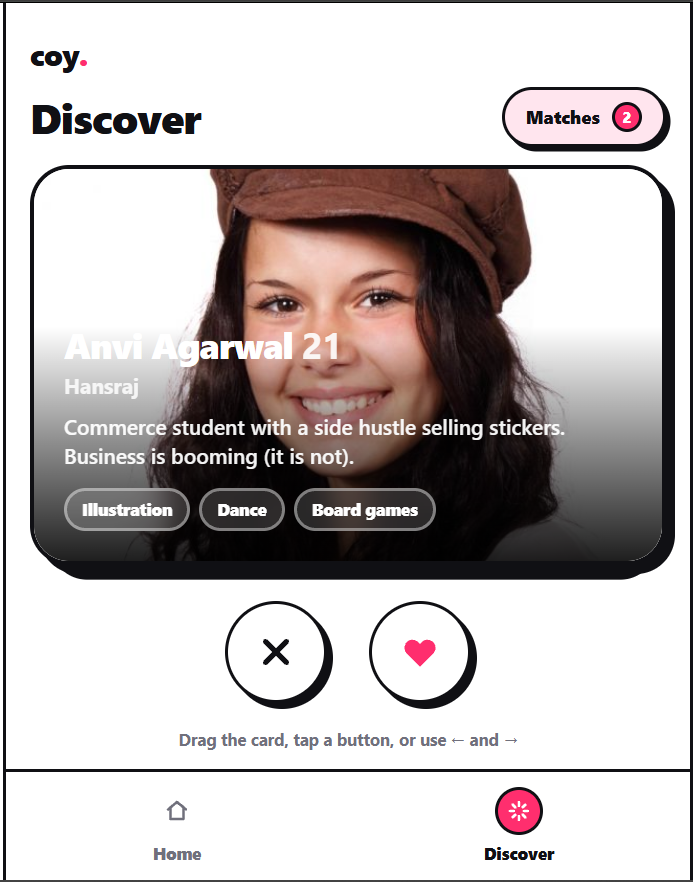
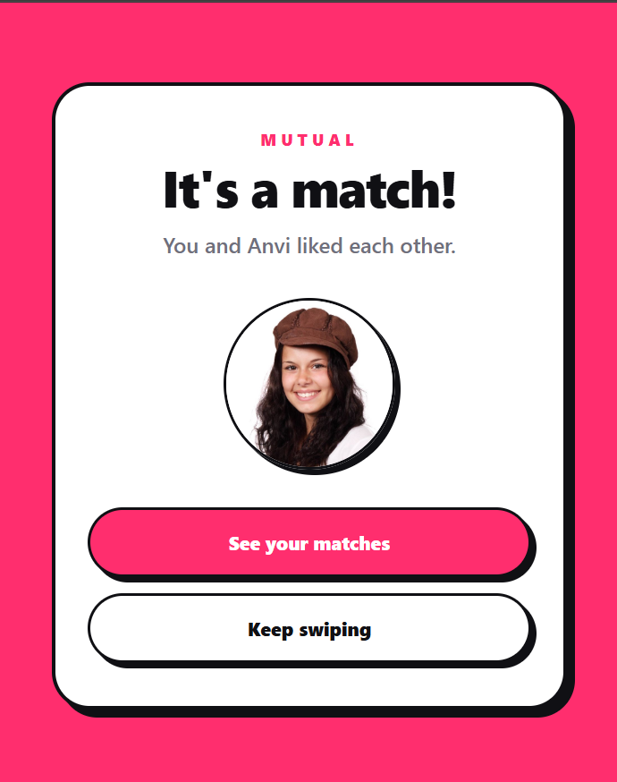
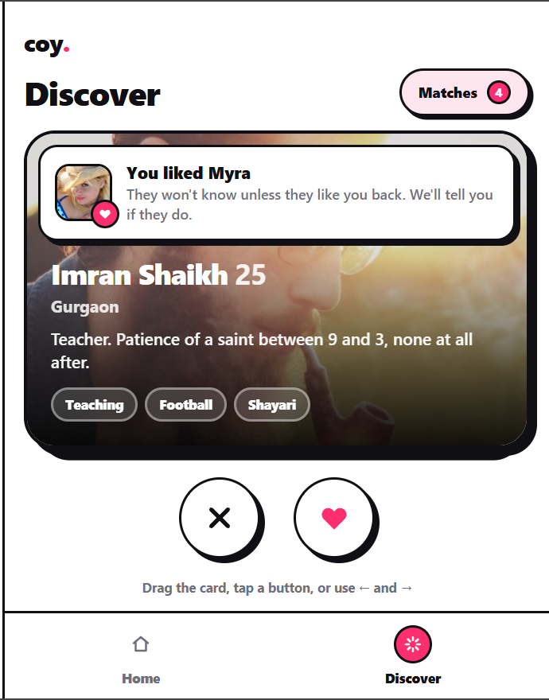
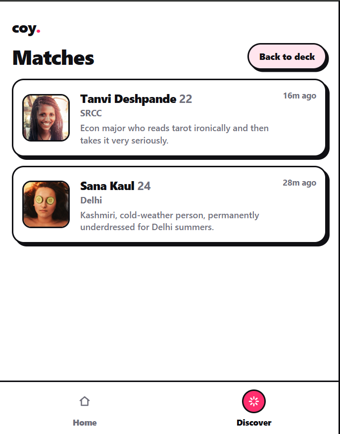
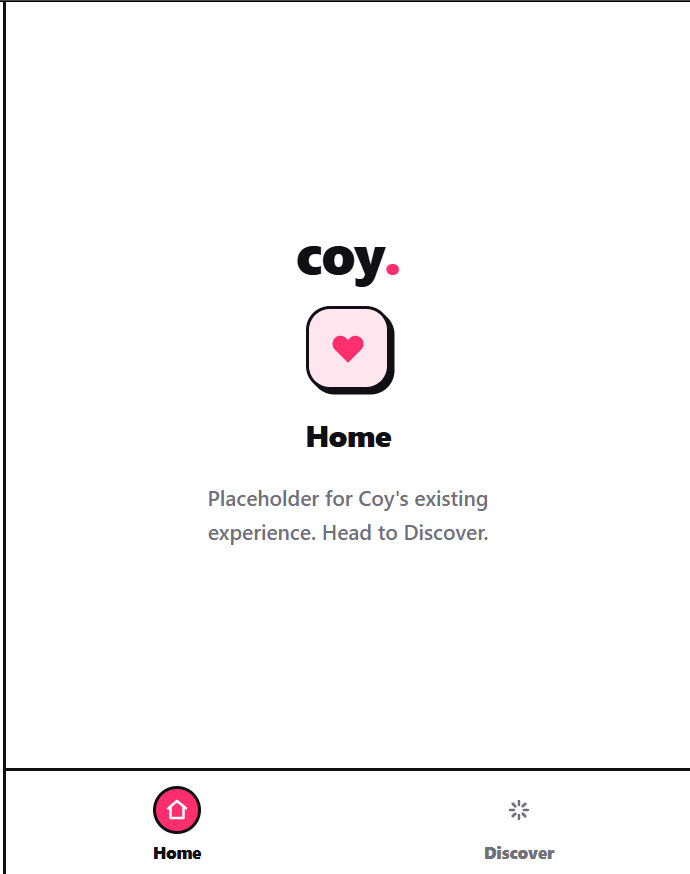

# Coy — Discover

A swipe-based discovery tab for Coy. A placeholder **Home** tab sits alongside
**Discover**, which holds the swipe deck, the match screen and the matches list.

A match only happens when both people have liked each other, and until that
moment the app never reveals that someone liked you.

| Discover | It's a match! |
| --- | --- |
|  |  |
| **A like that isn't mutual** | **Matches** |
|  |  |
| **Home (placeholder)** | |
|  | |

**Stack:** Next.js (App Router) · TypeScript · Tailwind · framer-motion ·
SQLite over libSQL — a local file in development, Turso when deployed.

---

## Quick start

```bash
npm install
npm run seed
npm run dev          # http://localhost:3000
```

The layout is mobile-first — open it at a phone width or use the browser's
device toolbar.

```bash
npm test             # 28 backend tests
npm run build        # production build
```

---

## Try it in 60 seconds

1. Open **Discover**. 36 profiles, one card at a time.
2. Drag right to like, left to pass. On desktop use the buttons or ← / →.
3. **To see a match:** 13 of the seeded profiles have already liked you. The
   third card in the deck is one of them — pass twice, then like.
4. A like that is *not* mutual shows a small confirmation instead. It reports
   only your own action — saying anything about the other person would leak
   the thing the app promises to hide.
5. **Matches** in the header lists mutual matches only.
6. Reload the page. Swiped profiles stay gone and matches persist, because the
   state is in the database rather than the browser.

The deck is finite, so swiping all 36 reaches the empty state. It offers
**Reset demo data** in development; `npm run seed -- --reset` does the same.

---

## Requirements checklist

**Profile data**
- [x] 36 seeded profiles with name, age, photo, bio, city/college, interests
- [x] 13 of them have already liked the user, so a match is demoable

**Swipe experience**
- [x] One card at a time
- [x] Drag gestures on mobile, buttons on desktop (plus arrow keys)
- [x] Card animation with LIKE / NOPE feedback as you drag
- [x] A swiped profile never reappears — enforced in SQL, not client state
- [x] Empty state when the deck runs out

**Matching**
- [x] A match requires likes in both directions
- [x] "It's a match!" screen at that moment
- [x] Matches view listing mutual matches
- [x] Who liked you is never revealed unless it is mutual

**Backend**
- [x] `GET /feed` — profiles not yet swiped on
- [x] `POST /swipe` — records a like or pass, reports whether it matched
- [x] `GET /matches` — mutual matches
- [x] Swipes and matches persist across reloads (SQLite, not client state)

---

## The privacy promise

> Never reveal who has liked the user unless it is mutual.

This is the requirement that shaped the design. A payload that leaks is not
fixed by a UI that declines to render the field — anyone can open the network
tab — so the guarantee is enforced server-side and covered by tests.

**1. No like state crosses the wire.** `GET /feed` returns `id, name, age,
photoUrl, bio, location, interests` and nothing else. Responses are built field
by field in `toProfileDTO` rather than by spreading a database row, so a column
added later cannot leak into a payload by accident. One test asserts the exact
key set on every profile; another greps the serialised payload for
like-related words.

**2. Ordering is not a side channel.** If profiles that had already liked you
drifted toward the front of the deck, the app would reveal them without ever
naming them. The deck is ordered by a salted hash of the profile id, which
depends on nothing like-related. A test asserts that admirers are spread
through the deck rather than clustered at the front.

**3. A one-sided like is indistinguishable from a pass.** `POST /swipe`
returns `{ "matched": false }` for both, and attaches the profile only on a
real match, so even the response size does not differentiate them.

**4. `GET /matches` returns mutual pairs only.** A one-sided like has no
representation in the matches table at all.

**5. The client cannot act as another user.** `POST /swipe` takes `targetId`
and `action` — there is no `swiperId`. The actor comes from
`getCurrentUserId()` on the server, and an extra `swiperId` in the body is
ignored.

---

## API

| Method | Route | Returns |
| --- | --- | --- |
| `GET` | `/feed?limit=50` | `{ profiles }` — not yet swiped on |
| `POST` | `/swipe` | `{ matched, profile? }` |
| `GET` | `/matches` | `{ matches: { profile, matchedAt }[] }` |
| `POST` | `/reset` | re-seeds; dev only unless `ALLOW_DEMO_RESET=true` |

The handlers live under `/api/*` by Next.js convention and are also served at
the bare paths above, so either works.

```bash
curl localhost:3000/feed
curl -X POST localhost:3000/swipe \
  -H 'Content-Type: application/json' \
  -d '{"targetId":"p01","action":"like"}'
curl localhost:3000/matches
```

`400` for a malformed body, an out-of-range limit or a self-swipe; `404` for
an unknown profile.

---

## Backend notes

**Swipes run as one atomic write batch.** The "have they liked me?" check and
the match insert must not be separated, or two simultaneous likes can both read
*no reverse like yet* and neither side ends up matched. An interactive
transaction would be correct but holds SQLite's single write lock across round
trips, stalling concurrent swipes — so the whole operation is a single
`batch('write')` of three statements:

1. insert the swipe, `ON CONFLICT DO NOTHING`
2. `INSERT INTO matches ... SELECT ... WHERE EXISTS (like one way) AND EXISTS
   (like the other way) ON CONFLICT DO NOTHING`
3. read back whether the match row exists

The check and the write are one statement with no read-modify-write gap.
`tests/concurrency.test.ts` fires both sides of a match simultaneously against
a file-backed database and asserts exactly one match row results.

**Other invariants.** `swipes` is keyed on `(swiper_id, target_id)`, so a double
tap cannot write twice and re-swiping returns the original outcome. A recorded
pass is never overwritten by a later like. `matches` stores the pair with
`user_a < user_b` under a `CHECK`, so it can exist in one direction only.
Request bodies are validated with zod.

---

## Frontend notes

- Drag with rotation tied to displacement, LIKE / NOPE stamps that fade in, and
  a commit threshold on either distance or flick velocity.
- Optimistic swipes: the card leaves immediately and the request follows. On
  failure the card returns to the deck with a toast, rather than a profile
  being silently lost.
- A swipe in flight blocks the next one, so a fast double tap cannot fire twice
  on the same card.
- Loading, error and empty states throughout.
- Keyboard support, labelled controls, `Escape` to dismiss the match screen,
  focus moved into it on open, and `prefers-reduced-motion` respected.
- Photos are placeholders from pravatar.cc, with a monogram fallback when an
  image cannot load.

**Visual design.** Hot pink `#ff2e6e` on white with near-black type, thick
black outlines and a hard un-blurred offset shadow, pill buttons and large
radii — following Coy's own interface. The `.hard`, `.hard-sm`, `.hard-lg` and
`.press` utilities in `globals.css` carry it.

---

## Tests

```bash
npm test
```

28 tests across two files, covering the parts where correctness matters:

| Area | What is asserted |
| --- | --- |
| Feed | excludes swiped profiles and the user; empties out; stable order |
| Privacy | exact key set; no like words in the payload; admirers not float-to-front; one-sided like identical to a pass |
| Matching | mutual only; never on a pass; works in either order; pair stored once |
| Idempotency | re-swiping returns the original outcome; a pass cannot be overturned |
| Validation | self-swipe and unknown profile rejected |
| Concurrency | simultaneous likes produce exactly one match |
| Seeding | 30+ profiles, admirers present, idempotent, reset clears state |

---

## Deploying

Vercel's filesystem is read-only and ephemeral, so a file-backed SQLite
database would lose every swipe. Turso is SQLite as a network service, which
leaves the schema and the SQL unchanged:

```bash
turso db create coy-discover
turso db show coy-discover --url     # TURSO_DATABASE_URL
turso db tokens create coy-discover  # TURSO_AUTH_TOKEN
```

Set both in Vercel. The client uses Turso when `TURSO_DATABASE_URL` is present
and a local file otherwise; the schema and seed are applied on first request.

With no auth, a deployed demo has one shared user, so everyone who opens the
link swipes the same deck. Set `ALLOW_DEMO_RESET=true` and
`NEXT_PUBLIC_ALLOW_DEMO_RESET=true` so the next person can start fresh.

---

## Trade-offs

- **The feed is ordered in the application, not in SQL.** Free at 36 profiles;
  at scale the deck rank would become an indexed column so the database can
  order and paginate.
- **No auth.** The brief says to assume one logged-in user, so the current user
  is a single server-side function. Adding a real session touches that one
  place, and no route reads a user id from the client.
- **No undo.** A swiped profile must never reappear, and an undo would also let
  someone probe for a reaction.
- **Tests cover the backend**, where the privacy guarantees live. Component
  tests for the drag thresholds would come next.

---

## Structure

```
src/
  app/
    page.tsx                   Home (placeholder)
    discover/page.tsx          swipe deck
    discover/matches/page.tsx  matches list
    api/{feed,swipe,matches,reset}/route.ts
  components/                  TabBar, SwipeDeck, ProfileCard, MatchOverlay,
                               LikeSentPopup, Avatar, DiscoverHeader, Wordmark
  lib/
    db/{schema.sql,client.ts,seed.ts,seed-data.ts}
    services/discover.ts       feed, swipe and match logic
    types.ts                   wire types, separate from row shapes
tests/                         discover.test.ts, concurrency.test.ts
```
